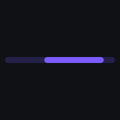

# Compose Loaders

A growing collection of loading indicators written in pure Compose. There are no Lottie files,
no images and no other assets: each loader is a single composable drawn on a `Canvas`.


- **25 loaders**, with new ones added every week. [LOADERS.md](LOADERS.md) is the registry, so none repeat.
- **Kotlin Multiplatform**: works on Android and Compose Desktop (JVM) from the same artifact.
- **Cheap to run**: frames redraw without recomposing, and loader draw code allocates nothing per
  frame (strokes, paths and brushes are built once per size). See [Performance](#performance).
- **Accessible**: screen reader labels, determinate progress, polite announcements, reduced motion
  that never freezes, and a test that no loader flashes more than three times a second.
- **Small**: depends only on Compose runtime, foundation, ui and animation. No Material dependency.

## Install

[](https://jitpack.io/#zainkhalid91/compose-loaders)

**1. Add the JitPack repository** in `settings.gradle.kts`:

```kotlin
dependencyResolutionManagement {
    repositories {
        google()
        mavenCentral()
        maven("https://jitpack.io")
    }
}
```

**2. Add the dependency** to your module's `build.gradle.kts`:

```kotlin
dependencies {
    implementation("com.github.zainkhalid91.compose-loaders:loaders:0.2.0")
}
```

<details>
<summary>Groovy, version catalog, Compose Multiplatform</summary>

Groovy (`settings.gradle` / `build.gradle`):

```groovy
maven { url 'https://jitpack.io' }

implementation 'com.github.zainkhalid91.compose-loaders:loaders:0.2.0'
```

Version catalog (`gradle/libs.versions.toml`):

```toml
[libraries]
compose-loaders = { module = "com.github.zainkhalid91.compose-loaders:loaders", version = "0.2.0" }
```

Compose Multiplatform: add it to `commonMain.dependencies { }`. Android and desktop (JVM)
targets are published.

</details>

Requirements: minSdk 23, compileSdk 36, Kotlin 2.0 or newer. The library is built against
Compose 1.10; if your app uses a newer Compose, Gradle uses yours.

## Use

```kotlin
import io.github.zainkhalid91.loaders.CometSpinner

CometSpinner()                                       // defaults: 48.dp, brand violet
CometSpinner(color = Color(0xFF22D3EE), size = 64.dp)
WaveBars(bars = 7, durationMillis = 800)
StripedBar(modifier = Modifier.fillMaxWidth())       // modifier sizes override the defaults
```

Every loader has the same shape of API:

| Parameter | Meaning |
|-----------|---------|
| `modifier` | Applied first, so a size set here wins over `size`. |
| `color` | Main tint, defaulting to the app-wide colour (see [App-wide defaults](#app-wide-defaults)). Some loaders also take `secondaryColor`, `trackColor`, `shadowColor`, `stripeColor`, `sandColor` or `dotColor`. |
| `size` | Square loaders: edge length (default 48.dp). Wide loaders: width, with height derived. Bars take `width` and `height`. |
| `durationMillis` | Length of one cycle. |
| `strokeWidth` | On ring and line loaders: `SpokeSpinner`, `ExpressiveArc`, `CometSpinner`, `DualRing`, `HeartbeatLine`, `LiquidFill`, `ClockSpinner`, `RadarSweep`, `Hourglass`. Unset means proportional to size. |
| `brush` | Gradient fill on `ExpressiveArc` and `WaveBars`. |
| count parameters | `spokes`, `dotCount`, `bars`, `rings`, `pairs`, `sparks` where it makes sense. |
| `progress` | `null` (default) for indeterminate, or 0 to 1 so screen readers read a percentage. |
| `config` | A [`LoaderConfig`](#loaderconfig): speed, pause, reduced motion, label, announcements. |

### LoaderConfig

One immutable object holds the behaviour every loader shares. A loader only recomposes when it
changes; drawing never reads it.

```kotlin
CometSpinner(
    config = LoaderConfig(
        speed = 1.5f,                         // multiplies the loader's own speed
        isRunning = true,                     // false stops on the current frame
        reducedMotion = ReducedMotion.Auto,   // Auto, On or Off
        label = stringResource(R.string.loading_photos),   // what a screen reader says
        announce = true,                      // polite announcement when it appears
    ),
)
```

### App-wide defaults

Set the brand colour and behaviour once, and every loader below picks them up:

```kotlin
ProvideLoaderDefaults(
    color = MaterialTheme.colorScheme.primary,
    config = LoaderConfig(label = stringResource(R.string.loading)),
) {
    AppContent()
}
```

`LocalLoaderColor` and `LocalLoaderConfig` are plain CompositionLocals if you prefer
`CompositionLocalProvider`. The library itself has no Material dependency; mapping from your
theme is the one line above.

## Accessibility

- **Screen readers.** Every loader is one merged node with a content description
  (`LoaderConfig.label`, default "Loading") and progress semantics. With `progress = null` it is
  indeterminate; pass `progress = 0.4f` and TalkBack reads the percentage.
- **Announcements.** With `announce = true` (the default) a loader is a polite live region, and its
  label arrives one frame after it appears, so the screen reader announces it once without
  interrupting. Turn it off where many loaders show at once, such as list placeholders.
- **Start and finish.** A loader can't announce that loading finished, because by then it is gone.
  `LoadingAnnouncer` stays in the layout and says both:

  ```kotlin
  LoadingAnnouncer(isLoading = state.loading, loadingLabel = "Loading photos", doneLabel = "Photos loaded")
  if (state.loading) CometSpinner(config = LoaderConfig(announce = false))
  ```
- **Reduced motion.** `ReducedMotion.Auto` follows the system: on Android, "Remove animations"
  (animator duration scale 0) switches to reduced motion. Compose Desktop has no such setting, so
  Auto means full motion there unless you provide a `MotionDurationScale` of 0. In reduced motion a
  loader holds a recognisable pose and slowly pulses its opacity (one breath every 2.4 s), so it
  still reads as busy. It never freezes, because a frozen spinner looks like a hung app. Other
  system scales are honoured: at 2x animation scale, loaders run at half speed.
- **No flashing.** A test renders every loader at 60 fps in full and reduced motion and checks
  WCAG 2.3.1: no more than three flashes in any second, measured over the loader's own area.
- **Contrast.** The default colour has 4.3:1 contrast on white and 4.8:1 on black, above the 3:1
  that WCAG 1.4.11 asks of graphics. No loader relies on colour alone to show it is busy.

## Performance

Loaders run on the frame clock (`withFrameNanos`) and read their progress only in the draw phase.
Strokes, paths, brushes and geometry are built once per size with `drawWithCache` and reused, so
loader code allocates nothing per frame. `AllocationTest` measures every loader on desktop against
a baseline animated dot, in bytes allocated per frame over 600 frames:

| Loader | 0.1.0 | 0.2.0 |
|---|---:|---:|
| FlippingSquare | 2,602 | 175 |
| CometSpinner | 887 | 8 |
| HeartbeatLine | 840 | 165 |
| LiquidFill | 647 | 376 |
| ChasingBlocks | 351 | 10 |
| DualRing | 252 | 26 |
| InfinityTrail | 243 | 0 |
| PulseRipple | 181 | 9 |

What remains on desktop is the renderer (Skiko), not loader code: the test's probes show about 24
bytes per `drawRoundRect` and about 200 bytes per path that is rebuilt and drawn in the same frame.
Android's `Canvas` and `Path` are native and have no such wrappers.

## Playground

The gallery app has a Playground tab: pick any loader and change its colour, hue, speed, size,
reduced motion and pause state, with the matching code shown underneath.

## The loaders

| | Name | | Name |
|---|---|---|---|
|  | `SpokeSpinner` |  | `ExpressiveArc` |
|  | `CometSpinner` |  | `DualRing` |
|  | `PulseRipple` |  | `BouncingDots` |
|  | `WaveBars` |  | `GridPulse` |
|  | `FlippingSquare` |  | `ChasingBlocks` |
|  | `NewtonCradle` |  | `InfinityTrail` |
|  | `DnaHelix` |  | `AtomOrbit` |
|  | `HeartbeatLine` |  | `MorphingPolygon` |
|  | `LiquidFill` |  | `ClockSpinner` |
|  | `BouncingBall` |  | `StripedBar` |
|  | `RadarSweep` |  | `Hourglass` |
|  | `PacDots` |  | `SlidingBar` |
|  | `FireworkBurst` | | |

What makes each one distinct is in [LOADERS.md](LOADERS.md).

## Project layout

| Module | What it is |
|--------|------------|
| `:loaders` | The library. One file per loader in `src/commonMain`. This is the only published module. |
| `:gallery` | The catalog of all loaders, a gallery screen, a desktop app, and the frame recorder for these GIFs. |
| `:sample` | Android app that shows the gallery. |
| `:benchmark` | Release-build Android app that compares frame times with an equivalent Lottie spinner (`tools/benchmark.ps1`). |

```bash
./gradlew :sample:installDebug        # gallery on an Android device
./gradlew :gallery:run                # gallery as a desktop window
./gradlew :loaders:desktopTest        # motion and accessibility tests
./gradlew :gallery:desktopTest        # registry, flash and allocation checks
./gradlew :gallery:recordFrames       # PNG frames of every loader in gallery/build/frames
./gradlew :gallery:recordDemoReel     # 1080 x 1350 feature demo; tools/make-gifs.sh encodes it
```

## Changes

See [CHANGELOG.md](CHANGELOG.md).

## Contributing

New loaders are welcome. See [CONTRIBUTING.md](CONTRIBUTING.md) for the checklist.

## License

MIT. See [LICENSE](LICENSE).
