# Compose Loaders

A growing collection of loading indicators written in pure Compose. There are no Lottie files,
no images and no other assets: each loader is a single composable drawn on a `Canvas`.

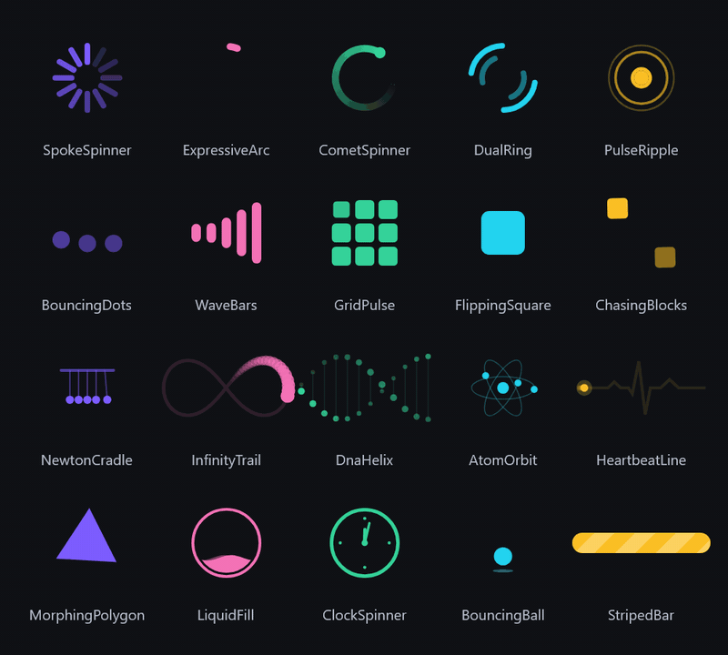

- **20 loaders**, with new ones added every week. [LOADERS.md](LOADERS.md) is the registry, so none repeat.
- **Kotlin Multiplatform**: works on Android and Compose Desktop (JVM) from the same artifact.
- **Cheap to run**: animations are read only in the draw phase, so a running loader re-draws
  each frame without recomposing.
- **Accessible**: every loader sets indeterminate progress semantics for TalkBack.
- **Small**: depends only on Compose runtime, foundation, ui and animation. No Material dependency.

## Install

[](https://jitpack.io/#zainkhalid91/compose-loaders)

**1. Add the JitPack repository** in `settings.gradle.kts`:

```kotlin
dependencyResolutionManagement {
    repositories {
        google()
        mavenCentral()
        maven("https://jitpack.io")
    }
}
```

**2. Add the dependency** to your module's `build.gradle.kts`:

```kotlin
dependencies {
    implementation("com.github.zainkhalid91.compose-loaders:loaders:0.1.0")
}
```

<details>
<summary>Groovy, version catalog, Compose Multiplatform</summary>

Groovy (`settings.gradle` / `build.gradle`):

```groovy
maven { url 'https://jitpack.io' }

implementation 'com.github.zainkhalid91.compose-loaders:loaders:0.1.0'
```

Version catalog (`gradle/libs.versions.toml`):

```toml
[libraries]
compose-loaders = { module = "com.github.zainkhalid91.compose-loaders:loaders", version = "0.1.0" }
```

Compose Multiplatform: add it to `commonMain.dependencies { }`. Android and desktop (JVM)
targets are published.

</details>

Requirements: minSdk 23, compileSdk 36, Kotlin 2.0 or newer. The library is built against
Compose 1.10; if your app uses a newer Compose, Gradle uses yours.

## Use

```kotlin
import io.github.zainkhalid91.loaders.CometSpinner

CometSpinner()                                       // defaults: 48.dp, brand violet
CometSpinner(color = Color(0xFF22D3EE), size = 64.dp)
WaveBars(bars = 7, durationMillis = 800)
StripedBar(modifier = Modifier.fillMaxWidth())       // modifier sizes override the defaults
```

Every loader has the same shape of API:

| Parameter | Meaning |
|-----------|---------|
| `modifier` | Applied first, so a size set here wins over `size`. |
| `color` | Main tint. Some loaders also take `secondaryColor`, `trackColor`, `shadowColor` or `stripeColor`. |
| `size` | Square loaders: edge length (default 48.dp). Wide loaders: width, with height derived. |
| `durationMillis` | Length of one cycle. |
| count parameters | `spokes`, `dotCount`, `bars`, `rings`, `pairs` where it makes sense. |

## The loaders

| | Name | | Name |
|---|---|---|---|
| 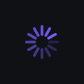 | `SpokeSpinner` | 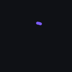 | `ExpressiveArc` |
| 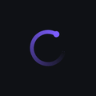 | `CometSpinner` | 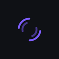 | `DualRing` |
| 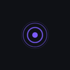 | `PulseRipple` | 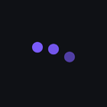 | `BouncingDots` |
| 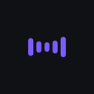 | `WaveBars` | 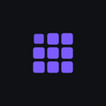 | `GridPulse` |
| 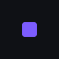 | `FlippingSquare` | 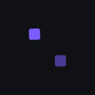 | `ChasingBlocks` |
| 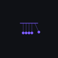 | `NewtonCradle` | 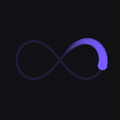 | `InfinityTrail` |
|  | `DnaHelix` |  | `AtomOrbit` |
| 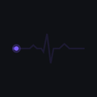 | `HeartbeatLine` | 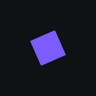 | `MorphingPolygon` |
| 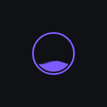 | `LiquidFill` | 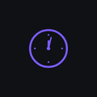 | `ClockSpinner` |
| 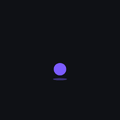 | `BouncingBall` | 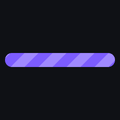 | `StripedBar` |

What makes each one distinct is in [LOADERS.md](LOADERS.md).

## Project layout

| Module | What it is |
|--------|------------|
| `:loaders` | The library. One file per loader in `src/commonMain`. This is the only published module. |
| `:gallery` | The catalog of all loaders, a gallery screen, a desktop app, and the frame recorder for these GIFs. |
| `:sample` | Android app that shows the gallery. |

```bash
./gradlew :sample:installDebug        # gallery on an Android device
./gradlew :gallery:run                # gallery as a desktop window
./gradlew :gallery:desktopTest        # registry checks
./gradlew :gallery:recordFrames       # PNG frames of every loader in gallery/build/frames
```

## Contributing

New loaders are welcome. See [CONTRIBUTING.md](CONTRIBUTING.md) for the checklist.

## License

MIT. See [LICENSE](LICENSE).
